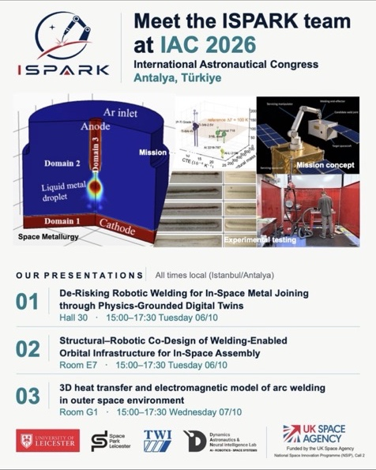
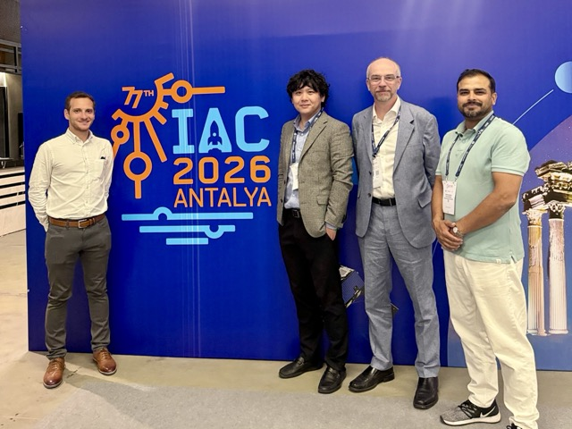
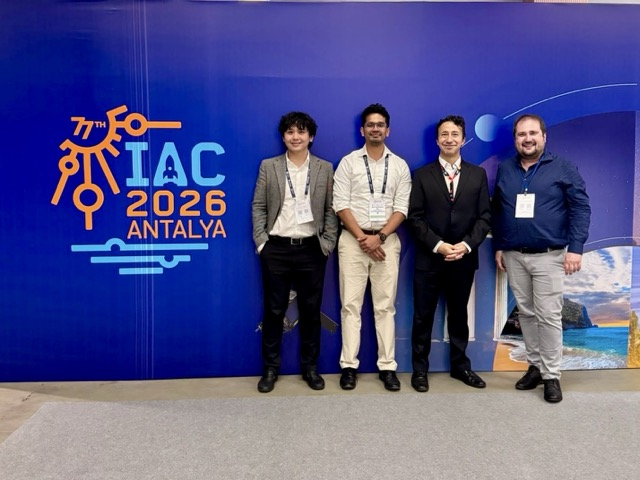
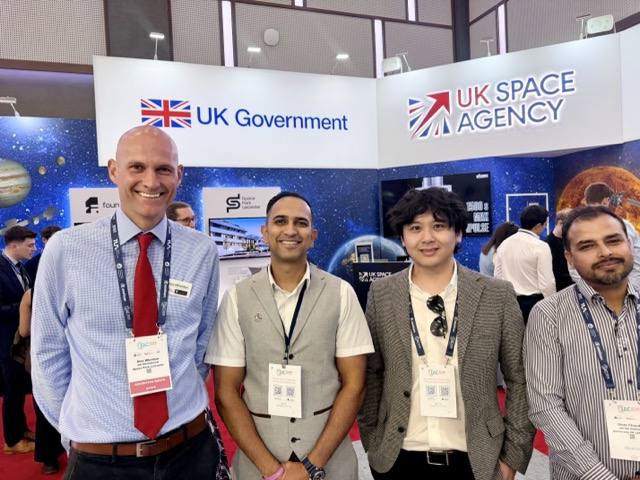

Three papers, three oral talks, one goal: making robotic welding in space a reality. Last week the ISPARK team took our work to the [77th International Astronautical Congress (IAC 2026)](https://www.iac2026.org/) in Antalya, Türkiye, the world's largest annual gathering of the space community.

If we want to build and repair large structures in orbit, we need to join metal there, and do it reliably with robots. Our three papers attack that problem from three directions: the physics of the arc and weld pool in space, a digital twin that tests welding strategies before any hardware flies, and the design of orbital structures together with the robots that will weld them.

### De-Risking Robotic Welding for In-Space Metal Joining Through Physics-Grounded Digital Twins

*Session A2.8, In-Space Manufacturing and Production Applications · Tuesday 6 October, Hall 30*

Arc welding in reduced gravity and near-vacuum is poorly understood, and flight-like tests are rare and expensive. This paper presents a physics-grounded digital twin that combines a reduced thermal weld-pool model, data-driven surrogates and a robotic-control simulation. It screens candidate welding conditions and control strategies in software before experiments begin.

**Links:** [IAF Digital Library](https://dl.iafastro.directory/event/IAC-2026/paper/114351/) · [arXiv (alternative version)](https://arxiv.org/abs/2610.21939)

### Structural–Robotic Co-Design of Welding-Enabled Orbital Infrastructure for In-Space Assembly

*Session C2.3, Space Structures · Tuesday 6 October, Room E7*

This paper looks at designing orbital structures and the robots that assemble them together, so that welded joints can be made reliably in orbit.

**Links:** [IAF Digital Library](https://dl.iafastro.directory/event/IAC-2026/paper/114343/)

### 3D Heat Transfer and Electromagnetic Model of Arc Welding in Outer Space Environment

*Session A2.2, Fluid and Materials Sciences · Wednesday 7 October, Room G1*

Dr Umer Chaudry presented our 3D model of the arc, the liquid metal droplet and the weld pool, coupling heat transfer with electromagnetics, to show how arc welding behaves in the space environment.

**Links:** [IAF Digital Library](https://dl.iafastro.directory/event/IAC-2026/paper/114829/)

### Around the congress

Thank you to everyone who came to our talks and stopped to talk with us. ISPARK is a collaboration between the University of Leicester, Space Park Leicester and TWI, funded by the UK Space Agency through the National Space Innovation Programme. Many thanks to our co-authors Umer Masood Chaudry, Richard Hampson, Ehsan Simaei, Robert Shaw, Andrew Cheney, Nick Ludford, Mark Sims and Hongbiao Dong.
